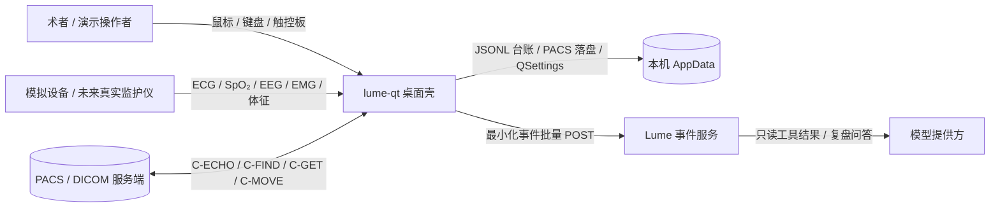
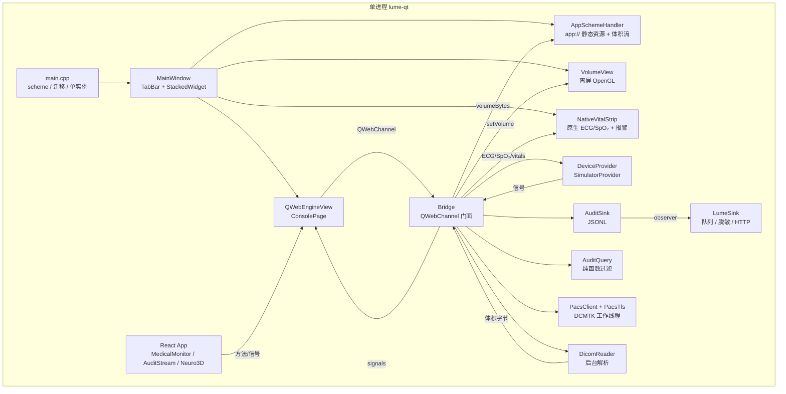
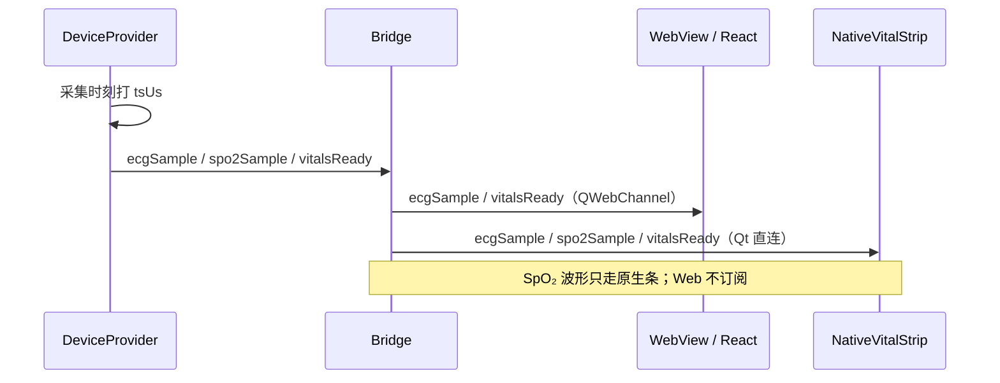
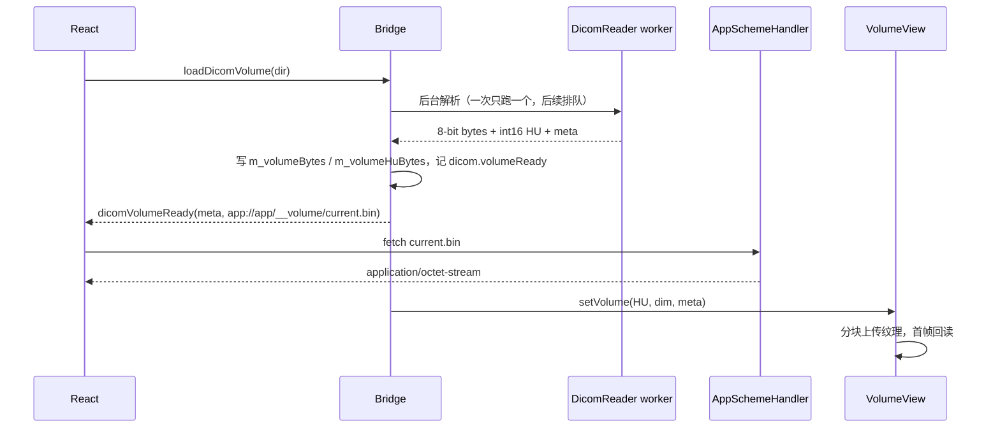
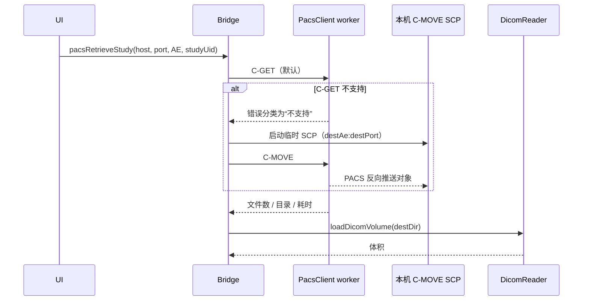
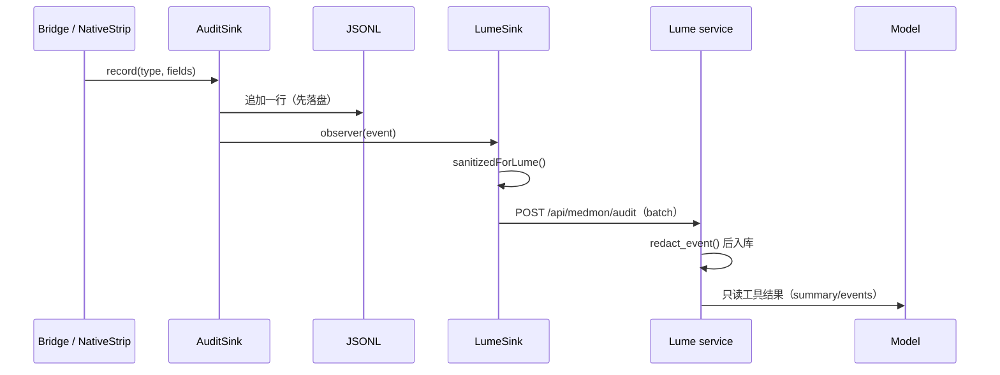

# lume-qt 架构文档

> 状态：2026-11-07，对应 `main` 分支当前实现。
> 范围：桌面壳、React 监护台、原生体渲染、DICOM/PACS、审计台账、Lume 复盘链路。
> 本文说明**系统怎么组成、数据怎么流、边界在哪里**，不重复 README 的逐条功能说明。
> 隐私与合规的威胁盘点见 [`privacy-compliance.md`](privacy-compliance.md)，需求追溯见 [`traceability.md`](traceability.md)。

## 1. 目标与约束

`lume-qt` 的目标不是把 Web 页面塞进一个窗口，而是做一个**术中可演示、可复核、可替换数据源**的桌面工作台：

1. 关键生命体征与报警不能依赖 WebView 的渲染/IPC 链路；
2. DICOM 体数据要能在原生 OpenGL 路径上按 HU 窗位/窗宽显示；
3. PACS 取回要覆盖 C-GET 与只支持 C-MOVE 的两类服务端；
4. 每一个会影响判断的事件都要落到本地台账，网络镜像不能成为单点；
5. 外部模型只能看到**最小化后的事件**，不能拿到原始患者/检查标识；
6. 界面必须一直明确“演示、非临床”。

### 1.1 质量属性优先级

| 优先级 | 属性 | 本项目的落点 |
|---|---|---|
| P0 | 不中断 | 设备信号、原生报警、本地台账不依赖 WebView/网络；Lume 断开只影响镜像 |
| P0 | 可追溯 | `AuditSink` 先落盘，再有观察者；固定 `ts/tsUs/session/type` |
| P1 | 可替换 | `DeviceProvider` 抽象设备；PACS 传输方式可选；Lume 只是可选服务 |
| P1 | 可解释 | 每个窗口/阈值/取回动作都有 UI 状态与台账事件 |
| P2 | 视觉一致 | Web/原生严格分 Tab；原生页深色 QSS 与 1:1 体渲染 |

### 1.2 非目标

- 不是医疗器械，不做临床诊断/治疗决策；
- 不做多租户、远程会诊、云端影像存储；
- 不把 React 组件当作临床报警的唯一定论；
- 不在本轮引入 CI，也不承诺 Windows 路径兼容；
- 不把 `docs/` 的工程记录包装成合规证据。

## 2. 系统上下文



信任边界：

- **本机进程内**：Qt 壳、Bridge、原生波形条、React 页面。默认认为本机用户可信，但仍按最小权限处理 PHI。
- **本机文件系统**：JSONL、PACS 目录、Lume SQLite 都可能含 PHI；不因为“在本机”就当作可以外发。
- **科室网络 / PACS**：DICOM 关联是外部输入，必须按不可信报文处理。
- **Lume / 模型**：外部或半外部服务；只接收白名单字段，但仍属于数据出境点。

## 3. 关键设计决策

| 决策 | 选择 | 代价 / 边界 |
|---|---|---|
| Web 与原生怎么共存 | 顶层两个 Tab，Web 页只有 `QWebEngineView`，原生页只有 `VolumeView` + `NativeVitalStrip` | 两套内容不能同屏并排；原生页没有 Web 控件 |
| 原生 3D 怎么画 | 离屏 `QOpenGLContext` + FBO + `glReadPixels` → `QImage` → `QPainter`，不用 `QOpenGLWidget` | 多一次回读；换来不与 WebEngine 的 GL 路径互踩 |
| 关键波形走哪 | `DeviceProvider → Bridge → NativeVitalStrip` 直连 Qt 信号 | Web 页看不到 SpO₂ 原生条；这是有意的隔离 |
| 体积二进制怎么给 Web | `app://app/__volume/current.bin` 走自定义 scheme，不走 QWebChannel 文本 | 需要注册 scheme、允许 Fetch API |
| 台账的权威在哪 | 本地 JSONL 先落盘；Lume 只是镜像 | Lume 不可用时只有本地证据，不阻塞业务 |
| PACS 怎么取 | 优先 C-GET；服务端不支持时回落 C-MOVE（本机临时 SCP） | C-MOVE 需要 PACS 侧登记 AE/端口 |
| 时间戳谁打 | `DeviceProvider` 在采集时刻打 `tsUs`；Bridge 只转发不重计时 | 真实设备时钟与宿主时钟可能有常量偏移，前端必须先估偏移 |
| 隐私在哪一层做 | 发端 `LumeSink::sanitizedForLume()` + Lume 侧 `redact_event()` 双层 | 本地台账保留全量；旧镜像库仍需单独清理 |
| 进程怎么保证单份状态 | `instance.lock` 只按 PID 判活，不用 `QLockFile` 的年龄判定 | `kill -9` 后下次启动可接管；正常退出清理 |

## 4. 组件视图



### 4.1 组件职责

| 组件 | 主要文件 | 负责 | 不负责 |
|---|---|---|---|
| 进程引导 | `src/main.cpp` | Chromium 节流开关、注册 `app://`、应用名、旧配置迁移、单实例锁 | 业务逻辑、UI 布局 |
| 宿主窗口 | `src/mainwindow.{h,cpp}` | 持久化 profile、两个顶层 Tab、原生页面装配、QSS、启动恢复、报警配置下发 | DICOM 解析、网络传输 |
| Web 页面 | `src/consolepage.{h,cpp}` | 把 JS console / 异常转发到终端 | 业务数据 |
| 资源服务 | `src/appschemehandler.{h,cpp}` | 静态资源 MIME、路径穿越校验、`current.bin` 体积供数 | 体积解析 |
| 桥接门面 | `src/bridge.{h,cpp}` | QWebChannel 契约、设备信号转发、PACS/DICOM 任务编排、恢复状态 | 直接绘制、直接写界面 |
| 设备抽象 | `src/deviceprovider.h`、`src/simulatorprovider.*` | 以“采集时刻 + 波形/体征信号”为契约输出数据 | 决定 UI 怎么显示 |
| 审计台账 | `src/auditsink.{h,cpp}` | JSONL 追加、按天/按大小轮转、固定字段、observer | 网络重试、字段脱敏 |
| 台账检索 | `src/auditquery.{h,cpp}` | 类型前缀、文本/数字子串、limit 的纯函数过滤 | 读文件、决定取哪一天 |
| Lume 上行 | `src/lumesink.{h,cpp}` | 发端脱敏、500 条队列、50 条批、超时/退避、配置拉取、Agent 问答 | 修改本地台账 |
| PACS | `src/pacsclient.*`、`src/pacstls.*` | C-ECHO/C-FIND/C-GET/C-MOVE、TLS 配置、错误分类 | 更新 UI（结果回主线程） |
| DICOM 体积 | `src/dicomreader.*` | 解析序列、重采样、8-bit + int16 HU、元信息 | 上传纹理、绘制 |
| 原生体渲染 | `src/volumeview.*` | 离屏 GL、纹理分块上传、窗/去骨/切面/伪彩、相机交互 | Web 页面、PACS 网络 |
| 原生波形条 | `src/vitalstrip.*` | ECG/SpO₂ 直绘、报警判定/静音/到期、原生事件台账 | Web 页渲染 |
| React 监护台 | `frontend/src/App.tsx`、`MedicalMonitor.tsx`、`Neuro3D.tsx` | 生命体征、ECG/超声、神经波形/3D、延迟看板、诊断 | 原生绘制、PACS 协议 |
| 台账/AI 面板 | `frontend/src/AuditStream.tsx` | 台账检索、`lumeReady`、`askLume`、工具轨迹提示 | 直接读文件或数据库 |
| 桥接封装 | `frontend/src/qwebchannel.ts` | 类型化方法/信号、连接生命周期 | 业务状态 |
| Lume 参考服务 | `tools/lume-medmon/app.lume` | 事件镜像、报警配置、三个只读 Agent 工具、聊天入口 | 临床判断、原始台账权威 |

## 5. 运行时视图

### 5.1 启动顺序

1. `main.cpp` 在 `QApplication` 构造前设置 Chromium flags，关闭遮挡/后台节流；再注册 `app://` scheme，开启 `SecureScheme`、`LocalScheme`、`CorsEnabled`、`FetchApiAllowed`。
2. 创建 `QApplication`，设置 `applicationName=lume-qt`、`organizationName=research`。
3. `migrateLegacyProfile()`：旧 `qt-react-shell` 目录整体迁到新 `AppDataLocation`；旧 `QSettings("research","qt-react-shell")` 逐键复制到新设置，不覆盖已有新键。
4. 获取 `state/instance.lock`：写 PID；若持有者仍存活则退出，死进程留下的锁直接接管。
5. `MainWindow` 创建持久化 `QWebEngineProfile("lume-qt")`、安装 `AppSchemeHandler`、关闭 HTTP cache；先 `setPage(ConsolePage)` 再 `setWebChannel`，避免 channel 绑到被替换的旧 page。
6. `Bridge` 构造：创建 `SimulatorProvider`、`AuditSink`、`LumeSink`，写 `session.start`；扫描未闭合会话，900 ms 后恢复上次体数据来源。
7. 装配两个 Tab：`[0] 监护台` 只放 `QWebEngineView`；`[1] 原生影像` 放 `VolumeView` + `NativeVitalStrip`；从 `QSettings` 恢复 `ui/mainTab`。
8. 加载 `app://app/index.html`；React 连接 bridge 后启动模拟信号和神经模拟，并请求样例体数据；原生页在布局稳定后补一次 `requestRender()`。

启动阶段的三个“不能晚”：

- Chromium 节流开关必须在 `QApplication` 前；
- scheme 注册必须在 `QApplication` 前；
- 旧数据迁移必须在任何 `QSettings`/`AppDataLocation` 读取前。

### 5.2 实时信号路径



不变量：

- `tsUs` 是采集时刻，不是 emit 时刻；Bridge 不重新计时。
- `QTRS_MUTE_SIGNALS=1` 只掐 Web 侧转发，原生条照常；`QTRS_SAMPLE_DIV` 只降 Web 侧频率。
- 原生条在原生 Tab 可见；它在后台仍接收信号以维持报警判定/台账，但不在 Web 页绘制。
- 报警阈值由 `alarmconfig` 校验；非法值不生效，记 `alarm.config`。

### 5.3 DICOM 体积链路



为什么二进制不走 QWebChannel：体积是数 MB 级，QWebChannel 的文本序列化会破坏字节；因此信号只带 URL，真正的字节由 scheme handler 直接供数。`Bridge` 里保留的是**主线程**副本，scheme handler 读取时不需要跨线程锁。

体积释放策略：

- 原生接管时，8-bit 副本默认释放；`QTRS_KEEP_VOLUME_BYTES` 才保留；
- int16 HU 副本建完纹理后默认释放；
- 60 s 后记 `volume.memory`，避免把“交接瞬间的引用”误当成稳态 RSS。

### 5.4 PACS 取回链路



关键点：

- PACS 请求是**单飞**：上一次未返回时不再开第二条；心跳是一条独立线程，长取回期间仍能 C-ECHO。
- 取回成功后 `m_authoritativeVolumeDir` 标记该目录；样例自动加载被忽略，防止“真实病例被演示数据覆盖”。
- 失败按错误分类重试；C-GET 的“不支持”才回落 C-MOVE，其他确定性错误不反复重试。
- C-MOVE 需要 PACS 侧登记本机 `QTRSSTORE`/端口；接收端目前是明文 SCP，TLS 只覆盖出站 SCU 路径。

### 5.5 审计与 Lume 链路



调用顺序是硬约束：**先写本地 JSONL，再通知 Lume**。网络失败只影响镜像；本地台账仍是唯一权威。

Lume 侧有两个读路径：

- `medmon_summary` / `medmon_events` / `medmon_review` 只返回白名单字段；
- `GET /api/medmon/events` 现在同样走 `redact_event()`，包括历史镜像行；`source` 里若带路径会折叠成 `<path>`。

### 5.6 配置下发与 AI 复盘

- `MainWindow` 启动时 `LumeSink::fetchConfig()` 拉 `/api/medmon/config`，2 s 超时；失败保持 env/默认阈值。
- `AuditStream` 先查 `bridge.lumeReady()`；未设置 `QTRS_LUME_URL` 时按钮禁用并提示。
- `askLume()` 走 `POST /react/api/chat`，SSE 收完后一次回调 `lumeAnswer`；结果包含 `mode: model|demo`、`notes` 工具轨迹。
- 模型只能通过 `medmon_*` 工具读台账；工具参数有限，不提供任意 SQL/任意事件查询。

## 6. 契约

### 6.1 Bridge 契约（QWebChannel）

| 类型 | 代表接口 | 用途 |
|---|---|---|
| 属性 | `appName`、`platform`、`nativeVolume` | 只读元信息；`nativeVolume` 决定 Web 是否还要自取体积 |
| 方法 | `startMedicalSimulation`、`loadDicomVolume`、`pacs*`、`queryAuditEvents`、`askLume` | JS → C++；长任务在 worker 里跑 |
| 信号 | `ecgSample`、`vitalsReady`、`dicomVolumeReady`、`pacsStatus`、`lumeAnswer` | C++ → JS；实时波形带 `tsUs` |
| 快照 | `pacsState`、`lastVolumeTiming`、`lastAlarmTiming`、`lastRecovery` | 解决“页面晚挂载、信号已经发过”的空白状态 |

约定：

- 所有 QWebChannel 调用都在主线程入口；Bridge 不把 `std::thread` 暴露给 JS。
- 事件型通道（体积、报警）除了信号还必须有可拉取的快照，不能假设页面在事件发生时已经挂载。

### 6.2 审计事件信封

```json
{
  "ts": "2026-11-06T23:12:52.873",
  "tsUs": 1793977972873284,
  "session": "20261106T231246-74228",
  "type": "watchdog.bad",
  "ageMs": 93,
  "source": "web-frontend"
}
```

- `ts`：本地墙钟，ISO-8601 毫秒；
- `tsUs`：epoch 微秒，用于延迟/单次耗时；
- `session`：启动时生成，`yyyyMMddTHHmmss-pid`；
- `type`：事件锚点，固定字段不允许业务覆盖；
- 其余字段按事件类型扩展。

### 6.3 Lume 上行契约

```json
POST /api/medmon/audit
{
  "app": "lume-qt",
  "sentAt": "2026-11-06T23:12:55.000",
  "events": [
    {
      "ts": "2026-11-06T23:12:52.873",
      "tsUs": 1793977972873284,
      "session": "20261106T231246-74228",
      "type": "watchdog.bad",
      "ageMs": 93,
      "source": "web-frontend"
    }
  ]
}
```

队列与重试：上限 500 条，单批 50 条，3 s 超时，失败 5 s 后重试；溢出丢最旧并计数。

### 6.4 脱敏矩阵

| 字段 | 本地 JSONL | 桌面壳 → Lume | Lume 镜像/读接口 |
|---|---|---|---|
| `studyUid` / `studyInstanceUid` | 原值 | 变为 `studyUidHash` / `studyInstanceUidHash`（SHA-256 前 16 hex） | 不在白名单，镜像丢弃 |
| `dir` / `destDir` / `sourceDir` / `path` / `filePath` | 原值 | 变为 `<key>Hash` | 不在白名单，镜像丢弃 |
| `patient*` / `accessionNumber` / `medicalRecordNumber` / `issuerOfPatientId` | 原值（如有） | 删除 | 不在白名单 |
| 消息中的绝对路径 | 原值 | `<path>` | 保留清洗后的消息 |
| 消息中的 DICOM UID | 原值 | `<uid>` | 保留清洗后的消息 |
| `source` 为路径 | 原值 | `<path>` | 再折叠为 `<path>`（兼容旧镜像行） |
| `source` 为 `web-frontend` 等标签 | 原值 | 原值 | 原值 |

哈希是稳定摘要，不是加密：同一输入可关联，但不能从摘要反推原值；用于“这是不是同一例”的相关性，不用于还原。

2026-11-07 起发端改为**字段白名单**：上表之外的字段默认丢弃，`personName` / `institutionName` / `referringPhysician` / `studyDescription` / `accession` / `operatorName` 等不会因为“没列进黑名单”而漏出。Lume 收端再做一次独立清洗：`message` / `source` 等字符串把路径与 UID 折叠为 `<path>` / `<uid>`，并直接丢弃 `studies` / `event` / `dir` / `studyUid` 等嵌套或标识字段。

### 6.5 Lume HTTP 接口

| 方法 | 路径 | 用途 |
|---|---|---|
| GET | `/health` | 服务存活 |
| POST | `/api/medmon/audit` | 接收桌面壳批量事件 |
| GET | `/api/medmon/config` | 下发报警阈值 |
| POST | `/api/medmon/config` | 更新报警阈值 |
| GET | `/api/medmon/summary` | 汇总计数 + 最后一条（白名单） |
| GET | `/api/medmon/events` | 最近事件（白名单） |
| GET | `/api/agent/ready` | 工具是否注册，返回 `/react/api/chat` |
| POST | `/react/api/chat` | Agent 复盘问答（由 Lume 框架提供） |

> Lume 参考实现的 `SrvReq` 没有 headers 字段，服务端无法校验 `QTRS_LUME_TOKEN`；该头只对前置反向代理/mTLS 有意义。直接暴露 8090 时，`POST /api/medmon/config` 仍可被匿名改阈值，必须保持 loopback 或由代理收口。

### 6.6 本机存储布局

```text
<AppDataLocation>/                 # macOS: ~/Library/Application Support/research/lume-qt
├── audit/audit-YYYYMMDD.jsonl     # 本地权威台账，按天 + 8 MB 轮转
├── pacs/<StudyInstanceUID>/       # C-GET/C-MOVE 落盘
├── state/instance.lock            # PID 单实例锁
└── state/volume.json              # 上次体数据来源（用于重启恢复）
```

Lume 参考服务的镜像库在 `tools/lume-medmon/.data/medmon.db`，不属于桌面壳权威数据；它是可重建的镜像。

## 7. 并发、线程与生命周期

| 执行体 | 线程 | 规则 |
|---|---|---|
| Qt UI / MainWindow / Bridge / AuditSink / LumeSink 队列 | GUI 主线程 | 不执行阻塞网络/解析；`AuditSink` 只允许主线程 |
| DICOM 解析 | 独立 `std::thread` | 单飞；有 `cancel`；结果用 `QMetaObject::invokeMethod` 回主线程；后续目录排队 |
| PACS 取回 / C-ECHO 心跳 | 独立 `std::thread` | 取回单飞；心跳独立，长取回期间仍可判在线；结果回主线程 |
| 原生 GL | GUI 主线程的 `paintEvent` / timer | 独立离屏上下文；纹理分块上传，避免长帧 |
| Lume HTTP | `QNetworkAccessManager` 异步 | 不阻塞 UI；队列有上限；失败退避 |

生命周期保护：

- `PacsThreadHolder` / `DicomThreadHolder` 用 `shared_ptr` 持有线程与 `alive` 标志；Bridge 析构后已入队的回调先看 `alive`，避免 use-after-free。
- 析构时先置 `alive=false`，再协作式 cancel，再 join；`std::thread` 若仍 joinable 会 `std::terminate()`，所以 holder 析构必须自己 join。
- 单实例锁只按 PID 判活：`kill -9` 留下的锁在下次启动时接管；正常退出删除自己的锁。
- `QTRS_RELOAD_MIN` 定期换 profile/page 重建渲染进程；这是 WebEngine 长时间运行的内存治理手段，不是业务重启。

## 8. 失败模式与处理

| 故障 | 表现 | 系统行为 | 证据 |
|---|---|---|---|
| DICOM 目录不可读 / 损坏 | 体数据不出现 | 后台解析失败，发 `dicomVolumeError`，写 `dicom.volumeError`；UI 保留旧画面 | 日志 + 台账 |
| PACS 连不上 | 状态“离线” | C-ECHO 心跳发现，写状态翻转；不阻塞本地波形 | `pacsStatus` + 台账 |
| C-GET 不支持 | 取回失败 | 自动回落 C-MOVE；需要本机 SCP 与 PACS AE 登记 | `pacs.retrieveFallback` |
| 取回中断 | 文件不全 | 按错误分类重试；确定性错误不重试；半例不标成功 | `pacs.retrieve` |
| WebEngine 加载失败 | 页面空白 | `ConsolePage` 输出 JS/加载错误；`app://` 404 有日志；先查 `resources/web/index.html` 与残留实例 | stderr |
| Lume 不可用 | 镜像断 | 本地台账继续；队列上限丢旧；AI 按钮禁用/报错 | `lumeReady` + 队列计数 |
| 进程被杀 | 无 `session.end` | 下次启动 `recoverLastSession()` 写 `session.recovered`，恢复上次体数据 | 台账 |
| 两个实例 | 状态互相覆盖 | PID 锁拒绝第二个启动 | `instance.lock` |
| 报警阈值非法 | 阈值不生效 | 保留默认/回退，warning + `alarm.config` | 台账 |

## 9. 安全与隐私边界

### 9.1 已经落地的控制

1. **发端最小化**：`LumeSink::sanitizedForLume()` 在进入网络队列前处理；患者键删除、标识键哈希、字符串路径/UID 清洗。
2. **服务端二次白名单**：`redact_event()` 在 Lume 落库、summary、events、Agent 工具返回值上统一执行。
3. **本地权威不外发**：JSONL 保留全量，仅本机使用；Lume 不接收原始 `studyUid` / `dir` / 患者键。
4. **界面标识**：顶栏“演示 · 非临床”；AI 面板标注只读台账、非诊疗。
5. **进程边界**：单实例锁防止两个界面共享/覆盖同一份台账与体数据状态。

### 9.2 残余风险

- Lume HTTP 没有鉴权/TLS，默认仅 `127.0.0.1`；`LUME_BIND` 改大后必须加前置鉴权/网络 ACL。
- 外部模型仍会看到脱敏后的事件摘要；需要数据处理协议/地域/留存确认。
- PACS 落盘、JSONL 没有自动保留期/删除审批/磁盘加密。
- 旧 `medmon.db` 可能含白名单化之前的历史行；即使读接口现在脱敏，库文件本身仍应按 PHI 清理/重建。
- 没有医疗器械注册、临床验证、QMS、电子签名；免责声明不等于合规。

## 10. 扩展点

| 要加什么 | 从哪里接 | 不能破坏的契约 |
|---|---|---|
| 真实监护仪 | 实现 `DeviceProvider`，在 `Bridge` 构造处替换 `SimulatorProvider` | 每个波形带采集时刻 `tsUs`；只发信号、不碰 UI；start/stop 幂等 |
| 新 PACS 传输方式 | 扩展 `PacsClient`；`Bridge` 的 `startRetrieveAttempt` 编排 | 结果回主线程；单飞；错误分类可重试 |
| 新原生影像控件 | `MainWindow::setupNativeVolume()` + `VolumeView` | 原生页不能塞 WebView；Web 页不能塞原生控件 |
| 新 Web 面板 | `frontend/src/App.tsx` / `MedicalMonitor` | 不假设 QWebChannel 调用同步返回；事件型通道要补快照 |
| 新 Lume 工具 | `tools/lume-medmon/app.lume` 注册 `tool`，并在提示词/UI 放开 | 只读、字段白名单、参数有限 |
| 打包分发 | `CMakeLists.txt` 启用 `MACOSX_BUNDLE`，资源进包 | bundle id 需固定；`resources/web/` 必须随包 |
| CI | 先验证目标镜像有 `qt6-webengine-dev` / `libdcmtk-dev` | 不把本地截图/手动验收冒充自动验收 |

## 11. 验证地图

| 层 | 手段 | 覆盖 |
|---|---|---|
| C++ 单测 | `ctest`：`VolumeStatsUnitTests`、`BridgeUnitTests` | 窗值纯函数、桥接契约、Lume 脱敏、PACS 状态 |
| 前端单测 | Vitest：`frontend/src/latency.test.ts` 等 | 延迟/通道健康/事件流纯函数 |
| 类型/构建 | `npm run typecheck`、`npm run build`、`make cpp` | 前端契约、C++ 编译、资源产物 |
| 追溯 | `make trace` | 需求 ID、状态、引用文件结构 |
| 端到端 | CDP + 整屏截图 + JSONL/日志 + Lume 探针 | Tab、原生页、报警、PACS、落库字段 |
| 浸泡 | `docs/soak-2026-11-06.md` | WebEngine 内存、看门狗、长时间运行 |

## 12. 术语

| 术语 | 含义 |
|---|---|
| 监护台 / Web 页 | React + QWebEngineView 的监护界面 Tab |
| 原生影像 / 原生页 | `VolumeView` + `NativeVitalStrip` 的 Qt 原生 Tab |
| 台账 | `AuditSink` 写的本地 JSONL，权威事件记录 |
| 镜像 | Lume 侧的 SQLite 事件副本，可重建 |
| 发端 | 桌面壳进入网络队列之前的脱敏层 |
| C-GET / C-MOVE | DICOM 取回方式；前者由本机发起 C-STORE，后者由 PACS 反推 |
| `tsUs` | 采集/事件时刻的 epoch 微秒；不是“发布时刻” |
| `nativeVolume` | 原生体渲染是否接管；为 true 时 Web 不重复拉体积 |

## 13. 相关文档

- [`../README.md`](../README.md) — 英文入口与运行说明
- [`../README.zh.md`](../README.zh.md) — 中文完整工程记录与环境变量表
- [`privacy-compliance.md`](privacy-compliance.md) — 隐私/合规审计与上线检查表
- [`lume-integration.md`](lume-integration.md) — 事件协议、配置下行、Agent 复盘
- [`traceability.md`](traceability.md) — 需求—实现—验证矩阵
- [`risk-analysis.md`](risk-analysis.md) — 危害与控制
- [`soak-2026-11-06.md`](soak-2026-11-06.md) — 浸泡记录
